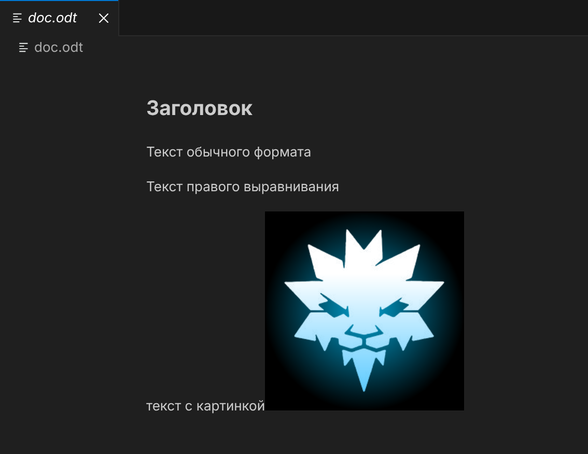

# Document Reader from Capitandirt

This extensions allows you to open ".odt" and ".docx" files inside your VS-code and view text, headers and pictures of a document.

## Features

If you open a ".odt" or ".docx" file in VS-code extension would open a custom-readonly-editor that shows you HTML page with file context.

Extension supports regular text, headers, tables and pictures in a file. All other details will be erased.

## Requirements

If you have any requirements or dependencies, add a section describing those and how to install and configure them.

## Known Issues

Extension now supports very few of all text options you can make with LibreOffice or MS Word. For example: no **bold** or *italic* or centered text.

## Author

Селин Андрей, группа М3109

## Release Notes

### 1.0.0

Initial release. Introduction of a main feature.